<p align="center">
  
</p>

```cpp
// whoami.cpp
struct SoraAsc {
    std::string name     = "Marcos Vinícios Dias Ferreira";
    std::string location = "Campos dos Goytacazes, RJ, Brazil";
    std::string studies  = "Computer Science @ UENF";

    std::vector<std::string> languages = {"C++", "TypeScript", "Python", "C#", "Rust"};

    std::vector<std::string> building = {
        "NNW: neural networks and reinforcement learning in C++",
        "Lambda: a language model trained from scratch",
    };

    std::vector<std::string> curious_about = {
        "small language models",
        "agents that learn to play games",
        "numerical optimization",
        "game development",
    };

    std::string approach = "rebuild it to understand it";
};
```

### About

I'm a Computer Science student at UENF, in Brazil. I like understanding how things work by building small versions of them, so lately I've been tinkering with a neural network library in C++, a small language model, and agents that learn to play games in the browser.

### Featured work

| Project | What it is | Stack | |
|---|---|---|---|
| [**NNW**](https://github.com/SoraAsc/NNW) | Neural network and reinforcement learning library: dense and convolutional layers, SGD/AdamW, PPO, Q-Learning, gradient-checked, with bindings for Python, C#/Unity and TypeScript/WebAssembly | C++ · CMake · WASM |  |
| [**Neural Playground**](https://soraasc.github.io/NeuralPlayground/) | A browser lab where agents learn to drive, balance a pendulum, and play Flappy, Pong and Asteroids. You can watch them train live | Vue · PixiJS · NNW |  |
| [**NeuralSnake**](https://github.com/SoraAsc/NeuralSnake) | Classic Snake played by a Q-Learning agent, in Unity | C# · Unity |  |
| [**Infinitia**](https://github.com/SoraAsc/Infinitia) | Image filters implemented by hand (grayscale, thresholding, Otsu) running in the browser | Vue · TypeScript |  |

More in my [repositories](https://github.com/SoraAsc?tab=repositories), including games, experiments and honest drafts.

### On the bench

| Area | Tools |
|---|---|
| **I write** | C++ · TypeScript · Python · C# · Rust |
| **I build with** | React · SolidJS · Vue · PixiJS · Unity |
| **Machine learning** | PyTorch · PPO and Q-Learning · BPE tokenization · linear attention |
| **Studying now** | numerical optimization, training small LLMs, systems architecture |


<p>
  <a href="https://linkedin.com/in/marcos-dias-f"></a>
  <a href="mailto:marcosfdias34@gmail.com"></a>
  
</p>

<p align="center">
  
</p>
